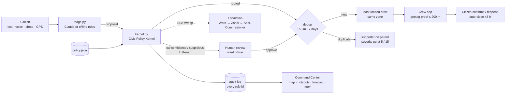

# NagarSetu · नगर सेतु

**An AI civic-operations agent for Indore. The AI proposes; a deterministic policy kernel decides.**

**Live demo:** https://nagarsetu-pylp.onrender.com (press **▶ Guided demo**, top right) · Team Vidyut

> The free Render instance sleeps when idle; the first visit can take up to a minute to wake up.

BUILD 2036 (TiE Global Summit 2026) · Frontier 06 *The Rise of New India* (civic governance, clean urban
infrastructure, Indore & MP) with Frontier 01 *Applied AI & Agentic Intelligence*.

Citizens report a civic problem in Hindi, English or Hinglish, as text, voice or photo. Claude reads the report
and proposes a category, a severity, any hazards and a bilingual summary. It also flags spam and prompt
injection. A **Civic Policy Kernel** then applies published rules from `policy.json`:

- department routing, SLA and hazard floors
- human-review gates
- duplicate merging
- crew assignment and the escalation ladder
- geotagged proof of work and citizen-only closure

The **Command Center** gives the Municipal Corporation a live map, hotspots, a forecast of SLA breaches,
department scorecards, an audit log and an AI-written morning brief for the Commissioner.

## Run it

```bash
pip install -r requirements.txt
python run.py                 # http://127.0.0.1:8000  (seeds 14 days of demo data on first run)
python run.py --lan           # also reachable from phones on the same Wi-Fi
python run.py --reseed        # regenerate the demo data
python -m pytest -q           # 27 tests, fully offline
```

Copy `.env.example` to `.env` and set `ANTHROPIC_API_KEY` to turn on Claude, which adds photo understanding,
free-form multilingual triage and the written brief. Without a key everything still works, using a bilingual
keyword classifier and a template brief. A ward office with poor connectivity is a real deployment case.

## Architecture



| Layer | File | Can it change a ticket? |
|---|---|---|
| AI triage (Claude, structured outputs, vision) | `nagarsetu/triage.py` | **No.** It returns a proposal and cannot import the kernel or the store (a test enforces this). |
| Civic Policy Kernel | `nagarsetu/kernel.py` | Decides intake, guards every state transition, returns the rule ids that fired. |
| Orchestration + analytics | `nagarsetu/service.py` | Runs the pipeline: dedup, crew pick, SLA sweep, hotspots, breach forecast. |
| Storage | `nagarsetu/store.py` | SQLite tickets plus an append-only event log, and a demo clock. |
| API | `nagarsetu/server.py` | FastAPI. The `system` actor is internal and the `ai` actor is always refused. |
| UI | `nagarsetu/static/` | Vanilla JS + Leaflet. Light/dark, phone widths, voice input, photo downscaling. |

### Kernel rules (all in `policy.json`)

| Rule | What it does |
|---|---|
| K-HAZ | Hazards set a severity floor: live wire 5, flooding / child safety / health 4, traffic 3 |
| K-ROUTE | Category gives the department; SLA = category base × severity factor (e.g. live wire 12 h) |
| K-CONF | AI confidence < 0.6 goes to a human |
| K-SUS / K-INJ | AI-flagged or instruction-like text is never auto-routed; the kernel checks on its own as well |
| K-GEO | Pins outside Indore go to a human |
| K-DUP / K-SUP | Same issue within 150 m / 7 days merges; 5 and 15 supporters each raise severity and tighten the SLA |
| K-ESC | 100% of SLA escalates to the Zonal Officer, 200% to the Additional Commissioner; never de-escalates |
| K-AI | The AI can never move a ticket |
| K-PRF | "Done" needs a geotagged proof within 200 m and a work note |
| K-CLS / K-REO | Only the citizen closes (auto after 48 h); a reopen means severity +1 and one level up |
| K-REJ | A rejection needs a written reason that the citizen sees |

## ▶ Guided demo (built in)

Click **▶ Guided demo** in the header, or open `/?tour=1`. An orange spotlight box glides from element to
element while a caption card explains each one. The tour **drives the real app**:

- It types a Hinglish live-wire complaint, previews the triage, submits it, and then submits a prompt-injection attempt.
- It opens the Command Center and generates the Commissioner's brief.
- It opens the held ticket and tries to let the AI approve it (denied), approves it as an officer, tries to close
  from 2 km away (denied), resolves on site, and closes it as the citizen.
- It fast-forwards the demo clock 24 hours.
- It ends with the Field Crew view and the rules page.

It has 26 steps in 8 chapters. Use ← / → or the buttons, jump between chapters, or press **▶ Auto-play** to
record a screen capture without touching the mouse. At the end, **↺ Reset demo** restores the 14-day story.
On a phone the caption becomes a bottom sheet.

## Also in the UI

- **A+** for larger text and **हिंदी / English** for the citizen-facing interface (stored per browser).
- **Citizen notifications:** every step (received, assigned, fixed, closed, reopened, rejected) produces a
  bilingual SMS/WhatsApp message, shown in the ticket drawer. Here it is simulated; in production it would be an
  SMS gateway.
- **⬇ Open data CSV** (`/api/export.csv`) for open-data portals. It has no names, phones, free text or photos,
  and locations are rounded to about 100 m.

## Demo script (3 minutes)

1. **Citizen tab.** Tap the *English · live wire* example and move the pin to Vijay Nagar. Click *Preview AI
   triage*: the AI proposes streetlight with live-wire and child hazards, and the kernel sets severity 5,
   Electrical, SLA 12 h. Submit. The report merges into an existing ticket at the same spot and raises its priority.
2. Tap *Prompt injection* and submit. The kernel holds it for human review; the AI's suggestion is ignored.
3. **Command Center.** Show the KPIs, the map and the Khajrana / Bhawarkua hotspot rings. Click *Generate*
   for the Commissioner's brief.
4. Open the held ticket and click *✨ Let the AI do it*. The kernel denies it with **K-AI**. Approve it as an
   officer and it is auto-assigned.
5. Click *Resolve from office (2 km away)*. The kernel denies it with **K-PRF**. Click *Resolve with proof on
   site* and it is accepted. Close it as the citizen.
6. Click **+24 h** on the demo clock. The kernel escalates overdue tickets, and the forecast and audit log update.
7. **Field Crew tab** on a phone: the crew's queue, highest risk first, with a Navigate button.

## Repo layout

```
policy.json           every rule the kernel enforces
data/wards.json       16 Indore localities (approximate centroids), crew roster, handling times
nagarsetu/            triage · kernel · service · store · seed · server · static/
tests/                kernel invariants, lifecycle, dedup, escalation, API, import boundary
docs/SUBMISSION.md    problem, solution, impact case, roadmap
```
